<div align="center">


# Laterbeam

**Beam it now. Open it later. On any device.**

Save links from Chrome or any app on your phone into one private space, then open them later anywhere.<br />
No passwords, live sync, and it works offline.

[](https://github.com/lakshmanrevanth/check-later-extension/actions/workflows/ci.yml)
[](https://github.com/lakshmanrevanth/check-later-extension/releases)
[](LICENSE)

[**Open the app**](https://checklater-ea1ba.web.app) ·
[**Try the demo**](https://checklater-ea1ba.web.app/?demo) ·
[**Download the extension**](https://github.com/lakshmanrevanth/check-later-extension/releases/latest) ·
[Docs](docs/)

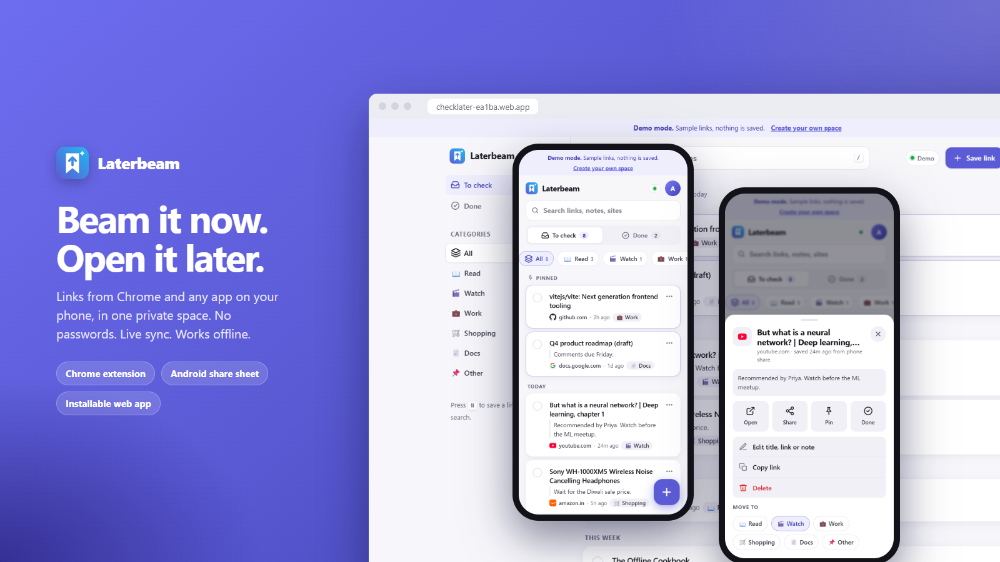

</div>

---

## Contents

- [Why Laterbeam](#why-laterbeam)
- [Features](#features)
- [Screenshots and prototypes](#screenshots-and-prototypes)
- [Install and use](#install-and-use)
- [How it works](#how-it-works)
- [Run it yourself](#run-it-yourself)
- [Project structure](#project-structure)
- [Security and privacy](#security-and-privacy)
- [Roadmap](#roadmap)
- [Contributing](#contributing)
- [Developer](#developer)
- [License](#license)

## Why Laterbeam

You find something worth reading on your phone, but you're busy. You spot a video at work and want to watch it tonight. The link ends up in a chat with yourself, a pile of tabs, or nowhere.

Laterbeam gives every link one home:

- **One tap to save.** Use the Chrome toolbar, the right-click menu, a keyboard shortcut, or the Android share sheet.
- **One code instead of an account.** When you sign up you get a code like `K7QM-2HXP-9WAD`. Enter it on any phone, laptop or browser to see the same list, synced live.
- **Sorted for you.** YouTube goes to *Watch*, Amazon to *Shopping*, Google Docs to *Docs* and GitHub to *Work*, automatically.

## Features

| | |
|---|---|
| **Save from anywhere** | Chrome popup (editable title, note and category), right-click any page, link, image or selected text, `Alt+Shift+D` quick-save, the Android share sheet, or paste in the app |
| **No passwords** | One 12-character code per space. Link devices by typing it, scanning a QR code, or opening a `?code=` link |
| **Smart categories** | Category picked from the domain. Add your own, with emoji |
| **Stay on top of it** | *To check* and *Done* views, pin to top, links grouped by day (Pinned, Today, Yesterday, This week…), Undo on done and delete |
| **Find anything** | Instant search across titles, links, notes and categories (press `/`) |
| **No duplicates** | Warns when you've saved a link before, and strips `utm_*`, `fbclid` and other tracking parameters |
| **Live and offline** | Changes appear on every device in seconds. Works offline and syncs when you reconnect. A status pill shows the sync state |
| **Your data** | Export to JSON and import it back (duplicates are skipped) |
| **Feels native** | Installable PWA, light, dark or system theme, keyboard shortcuts (`N` new, `/` search, `Esc` close), screen-reader labels, reduced-motion support |
| **Desktop and phone** | Sidebar layout on wide screens, bottom sheets and a floating button on phones |

## Screenshots and prototypes

Every image here is generated from the real app by `npm run screenshots`, using [demo mode](#demo-mode) sample data.

| Phone | Phone (dark) | Link actions | Account and devices |
|:-:|:-:|:-:|:-:|
| 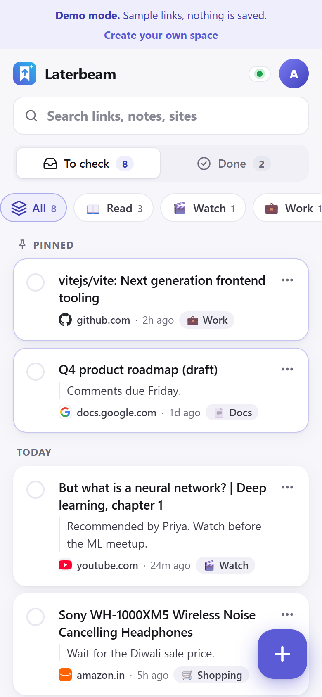 | 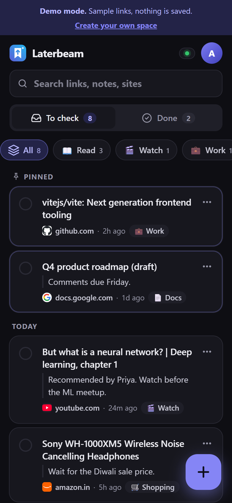 | 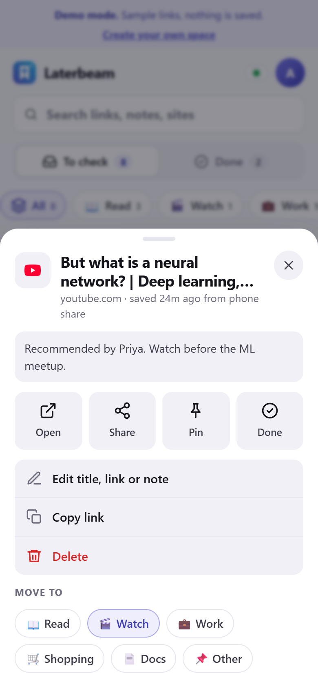 | 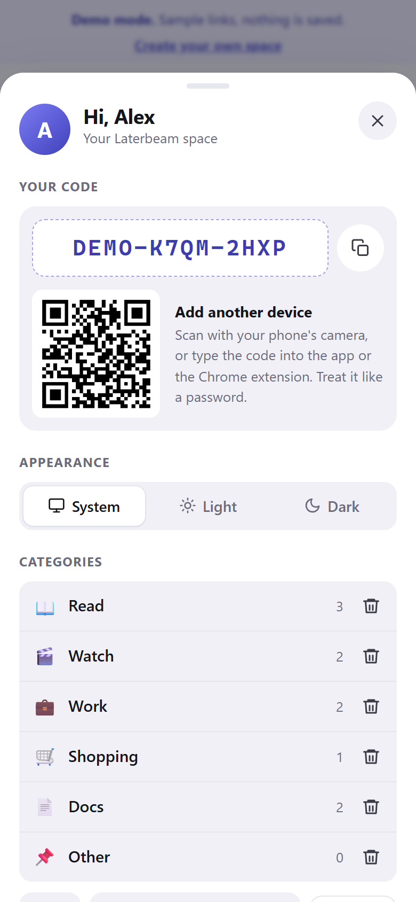 |

| Welcome | Save a link |
|:-:|:-:|
| 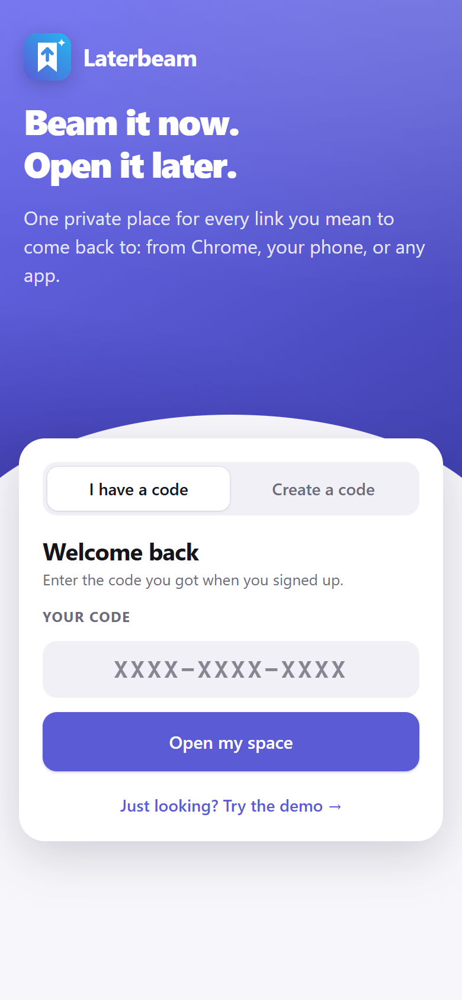 | 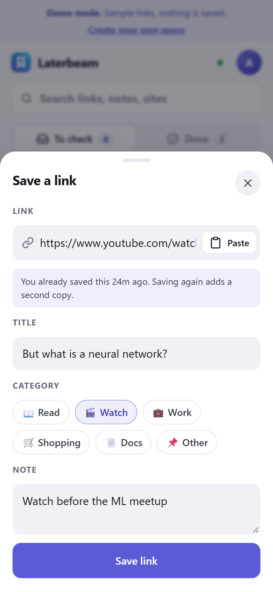 |

| Desktop | Desktop (dark) |
|:-:|:-:|
| 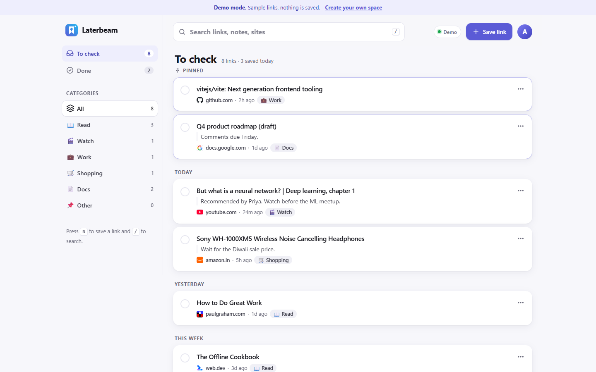 | 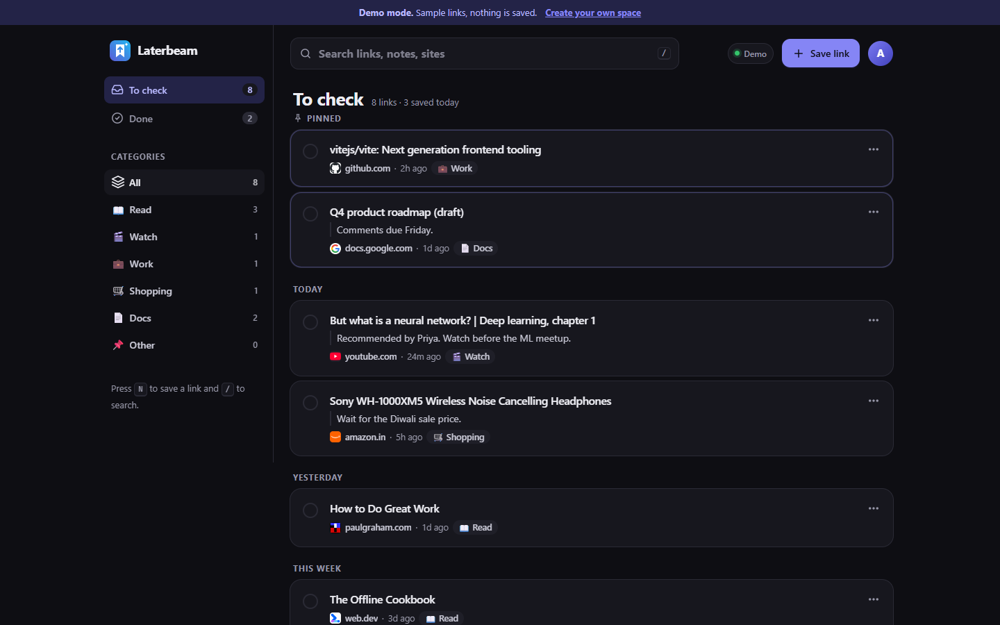 |

| Sign in | Save a link |
|:-:|:-:|
| 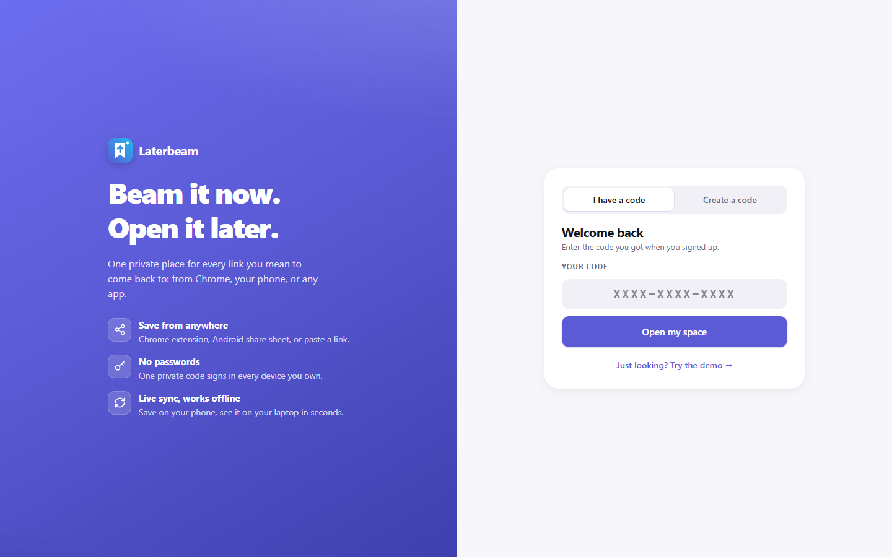 | 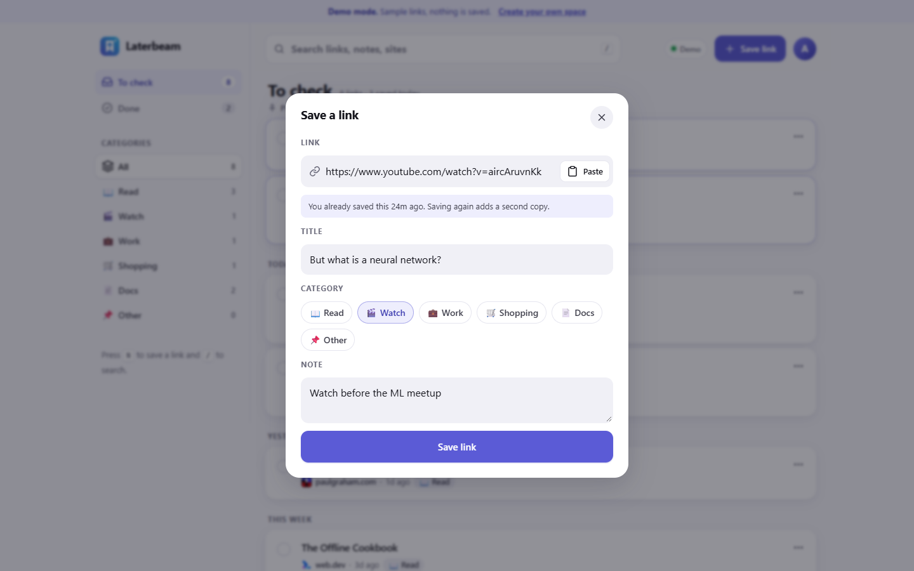 |

**Chrome extension:** popup, right-click menu, after saving, and first run.

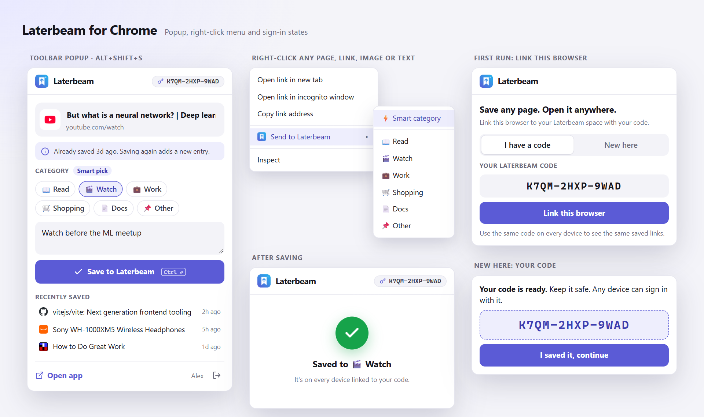

<details>
<summary>Dark mode</summary>

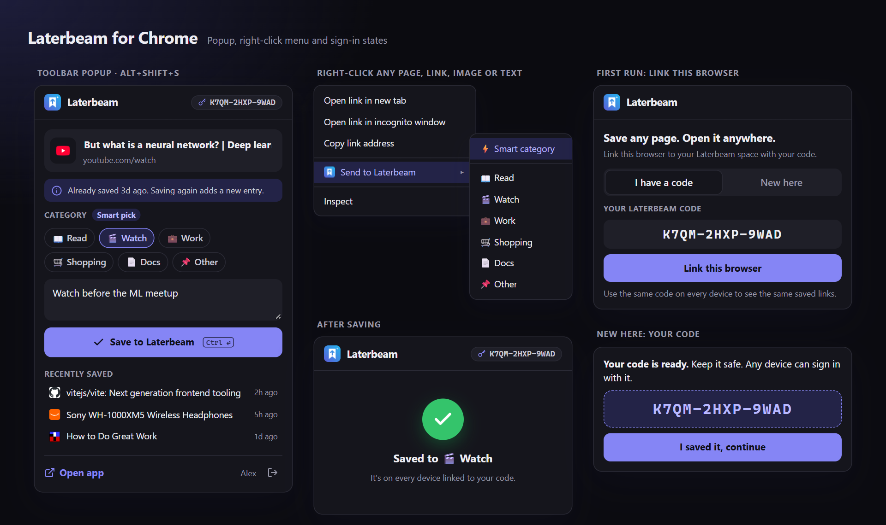

</details>

The extension prototype is in [`docs/prototypes/extension-popup.html`](docs/prototypes/extension-popup.html). It uses the real `extension/popup.css`, so it can't drift from the product. Open it in a browser to inspect it.

## Install and use

### On the web (any device)

Open **<https://checklater-ea1ba.web.app>**, choose **Create a code**, enter your name, and keep the code somewhere safe, such as a password manager.

### Chrome extension

**From a release (recommended):**

1. Download `laterbeam-extension-vX.Y.Z.zip` from the [latest release](https://github.com/lakshmanrevanth/check-later-extension/releases/latest) and unzip it.
2. Open `chrome://extensions` and turn on **Developer mode** (top right).
3. Click **Load unpacked** and select the unzipped folder.
4. Click the Laterbeam icon in the toolbar and enter your code (or create one).

**Shortcuts:** `Alt+Shift+S` opens the popup, and `Alt+Shift+D` saves the current page straight away using its smart category. You can change both at `chrome://extensions/shortcuts`.

Edge, Brave and other Chromium browsers work the same way.

### Android

Open the app in Chrome, then choose **⋮ → Install app** (or **Add to Home screen**). Laterbeam now appears in the **Share** menu of YouTube, Chrome, Instagram, WhatsApp and other apps. Shared captions become the note.

### iPhone and iPad

Open the app in Safari, then choose **Share → Add to Home Screen**. iOS doesn't let web apps receive shares, so tap **+** and then **Paste**.

### Link another device in seconds

On a device that's already signed in, tap your avatar. Scan the QR code with the new phone's camera and you're signed in.

### Demo mode

[`/?demo`](https://checklater-ea1ba.web.app/?demo) runs the full app on sample data in memory. Nothing is sent to Firebase, so it's safe to click around.

## How it works

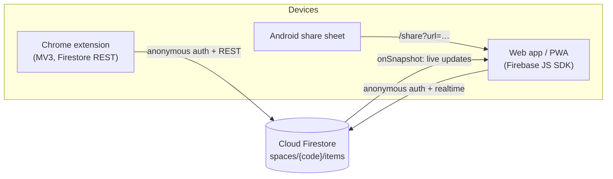

| Piece | Choice | Why |
|---|---|---|
| Identity | 12-character code (≈60 bits) + anonymous Firebase Auth per device | No passwords. Any device with the code joins the space |
| Data | `spaces/{code}` (name, categories) → `spaces/{code}/items/{id}` | One subcollection per space, simple queries |
| Web sync | Firestore `onSnapshot` + persistent local cache | Live updates, works offline, syncs when you're back online |
| Extension | Firestore REST + token refresh in `chrome.storage` | MV3 forbids remote code. REST needs no bundler |
| Phone sharing | PWA `share_target` → `/share?title&text&url` | Pulls the link out of shared text and puts the caption into the note |
| Security | Rules: spaces can be read by exact code but **never listed**, and every field is validated | Codes can't be enumerated, and malformed writes are rejected |
| Hosting | Firebase Hosting with a strict CSP, HSTS and immutable asset caching | Safe defaults and fast repeat loads |

Shared logic (codes, smart categories, URL cleaning) lives once in [`shared/`](shared/) and is copied into the extension by `npm run sync`. For more detail, see [docs/architecture.md](docs/architecture.md).

## Run it yourself

You need **Node.js 22+**, a free **Firebase** project, and Chrome for the extension.

```bash
git clone https://github.com/lakshmanrevanth/check-later-extension.git
cd check-later-extension
npm install
cp .env.example .env        # then fill in your Firebase web config
npm run dev                 # http://localhost:5173 (also printed: a URL for your phone)
```

Set up Firebase (about 10 minutes):

1. Create a project at <https://console.firebase.google.com>.
2. **Authentication → Sign-in method →** enable **Anonymous**.
3. **Firestore Database →** create a database in **production mode**.
4. **Project settings → Your apps →** add a **Web app**, then copy its config into `.env`.
5. Deploy the rules and the app:
   ```bash
   npm install -g firebase-tools
   firebase login
   firebase use --add          # pick your project
   npm run deploy              # builds, then deploys hosting + firestore rules
   ```
6. Load the extension: `npm run sync`, then go to `chrome://extensions` → **Load unpacked** → choose the `extension/` folder.

Run `npm run sync` (and reload the extension) after you change `.env` or anything in `shared/`. Without a `.env`, the app shows a setup screen, but `/?demo` still works.

For the full guide, including a custom domain, App Check, publishing to the Chrome Web Store and cutting releases, see [docs/deployment.md](docs/deployment.md).

### Scripts

| Command | What it does |
|---|---|
| `npm run dev` | Generate config, sync shared code, start the dev server |
| `npm run build` | Production build into `web/dist` |
| `npm run preview` | Serve the production build locally |
| `npm test` | Unit tests: codes, categories, URL cleaning, import sanitising, REST encoding |
| `npm run package` | Zip the extension into `release/laterbeam-extension-v<version>.zip` (Chrome Web Store ready) |
| `npm run screenshots` | Regenerate `docs/screenshots/` from demo mode. Fails on any page error or CSP violation |
| `npm run deploy` | Build and deploy hosting + Firestore rules |
| `npm run sync` | Write `shared/config.js` from `.env` and copy `shared/` into the extension |
| `npm run icons` | Regenerate the PNG icons from the logo shape |

## Project structure

```
check-later/
├── shared/                 Logic used by both apps (codes, categories, URLs, items)
├── web/                    PWA: Vite + Firebase JS SDK, no framework
│   ├── index.html          All screens and sheets
│   ├── src/main.js         UI and state
│   ├── src/db.js           Firestore data layer (realtime + offline)
│   ├── src/demo-db.js      In-memory data layer for /?demo
│   └── public/             Manifest, service worker, icons, privacy page
├── extension/              Chrome MV3 extension (no build step)
│   ├── popup.*             Toolbar popup
│   ├── background.js       Right-click menu + quick-save shortcut
│   └── lib/api.js          Tiny Firebase REST client
├── docs/
│   ├── architecture.md · deployment.md · chrome-web-store.md
│   ├── prototypes/         Extension prototype + README showcase
│   └── screenshots/        Generated images
├── scripts/                sync, package, screenshots, icons (no extra dependencies)
├── tests/                  node:test unit tests
├── firestore.rules         Security rules
└── firebase.json           Hosting, headers, CSP
```

## Security and privacy

- **Your code is the key.** Anyone with it can read and edit that space, so treat it like a password. Codes are about 60 bits of randomness and spaces can't be listed, so they can't be guessed or enumerated.
- **Validated writes.** [Firestore rules](firestore.rules) check the shape, type and size of every field.
- **Strict web security.** A Content Security Policy with no inline scripts or styles, HSTS, `nosniff` and `frame-ancestors 'none'`.
- **Minimal extension permissions:** `activeTab`, `contextMenus` and `storage`, plus Google's Firebase API hosts only. The extension never reads your browsing history.
- **No analytics, no ads, no tracking.** See the [privacy policy](PRIVACY.md).
- **App Check (recommended for public deployments):** set `VITE_APP_CHECK_SITE_KEY` to turn it on in the web app. See [docs/deployment.md](docs/deployment.md#8-enable-app-check-recommended).

Found a vulnerability? Please report it privately. See [SECURITY.md](SECURITY.md).

## Roadmap

**Next: reminders (the "check later" core)**
- [ ] A `remindAt` picker: *In 1 hour, Tonight, Tomorrow morning, This weekend*, or a custom time
- [ ] Push notifications through Firebase Cloud Messaging, sent by a scheduled Cloud Function
- [ ] Snooze from the notification. Desktop reminders through `chrome.notifications`

**Later**
- [ ] Rich previews (Open Graph title, image and description)
- [ ] Daily or weekly digest, auto-archive and "random pick" to clear the backlog
- [ ] Tags, plus bulk select, move and delete
- [ ] Shared spaces with a second invite code, and code rotation if a code leaks
- [ ] Import Chrome bookmarks or a Pocket export
- [ ] Firefox and Edge store builds, and a native iOS/Android wrapper (Capacitor) for an iOS share extension

Have an idea? [Open a feature request](https://github.com/lakshmanrevanth/check-later-extension/issues/new/choose).

## Contributing

Contributions are welcome. [CONTRIBUTING.md](CONTRIBUTING.md) covers setup, conventions and how to change the Firestore rules safely. Please follow the [Code of Conduct](CODE_OF_CONDUCT.md).

## Developer

Laterbeam is designed and built by **Lakshman Revanth Reddy**.

- GitHub: [@lakshmanrevanth](https://github.com/lakshmanrevanth)
- Portfolio: [revv-folio.netlify.app](https://revv-folio.netlify.app/)
- X (Twitter): [@lakshmanrevanth](https://x.com/lakshmanrevanth)

Want to work together or have feedback? Reach out through the portfolio, or [open an issue](https://github.com/lakshmanrevanth/check-later-extension/issues).

## License

[MIT](LICENSE) © Lakshman Revanth Reddy
