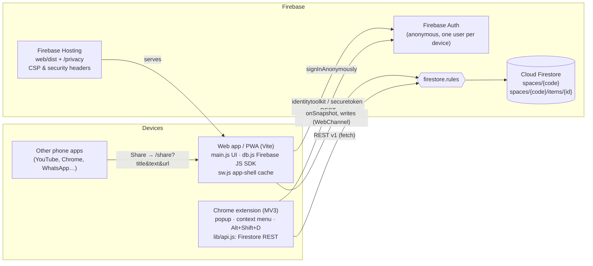

# Architecture

Laterbeam has two clients, the web app (PWA) and the Chrome extension, and one backend: a Firebase project with Anonymous Auth, Cloud Firestore and Hosting. There is no custom server.

## Components



Code is shared through `shared/` (`core.js`: codes, smart categories, URL cleaning, item shape; `config.js`: generated from `.env` by `npm run sync`). The web app imports it via the Vite alias `@shared`. The extension gets a copy in `extension/lib/shared/`, because Chrome can't load files from outside the extension folder.

## Data model

```
spaces/{code}                  code = XXXX-XXXX-XXXX, also the document id
  username, createdAt, categories[]
  items/{autoId}
    url, title, note, category, domain, favicon, source, status, pinned,
    createdAt, updatedAt, remindAt
```

### `spaces/{code}`

| Field | Type | Notes |
|---|---|---|
| `username` | string | 2–32 chars, set at creation, can't be changed afterwards |
| `createdAt` | timestamp | |
| `categories` | array of `{ id, name, emoji }` | ≤ 50 entries; the only field that can be updated |

### `spaces/{code}/items/{id}`

| Field | Type | Notes |
|---|---|---|
| `url` | string | Required, 1–4096 chars, tracking params stripped by `cleanUrl()` |
| `title` | string | Required; clients cap at 300 chars |
| `note` | string | Optional; clients cap at 2000 chars |
| `category` | string | Required; a category `id` from the space |
| `domain` | string | Hostname without `www.` |
| `favicon` | string | `https://www.google.com/s2/favicons?domain=…&sz=64` |
| `source` | string | `web`, `extension` or `share` |
| `status` | string | Required; `unread` or `done` |
| `pinned` | bool | |
| `createdAt` | timestamp | Required; server timestamp (web) or client time (extension) |
| `updatedAt` | timestamp | Set on every write |
| `remindAt` | timestamp or null | Reserved for reminders; currently always `null` |

Items are shaped by `buildItem()` in `shared/core.js` so both clients write the same fields. The authoritative size limits are in `firestore.rules`.

**Space codes** use a 32-character alphabet without look-alikes (no `0/O`, `1/I`). 12 characters give about 60 bits of randomness, generated with `crypto.getRandomValues`. On creation, each client checks that the code is free (a transaction on the web, a `409` on `POST ?documentId=` in the extension) and retries up to 5 times.

## Sync: web app

`web/src/db.js` uses the Firebase JS SDK:

1. `initializeFirestore` with `persistentLocalCache` + `persistentMultipleTabManager`, so data is kept in IndexedDB and shared across tabs.
2. `signInAnonymously` once per browser. The SDK persists and refreshes the token.
3. `onSnapshot` listeners on the space document (categories, username) and on `items` ordered by `createdAt desc`, with `includeMetadataChanges` so the UI can show pending writes and whether data came from the cache (sync status dot).
4. Writes (`addDoc`, `updateDoc`, `deleteDoc`, batched `moveItems`) apply to the local cache immediately and sync when the device is online. Undo after delete re-creates the item with its original id (`restoreItem`).

`web/public/sw.js` caches only the app shell, under a versioned cache name, so the app opens offline. Navigations are network-first and fall back to the cached shell. Data offline is handled by Firestore's cache, not the service worker.

In **demo mode** (`/?demo`) the data layer is replaced by sample data in memory and Firebase is never contacted.

## Sync: extension

MV3 forbids remote code, and the project avoids a bundler for the extension, so `extension/lib/api.js` is a small client over the REST APIs:

- **Auth:** `accounts:signUp` (Identity Toolkit) creates an anonymous user. `{ idToken, refreshToken, expiresAt }` is stored in `chrome.storage.local`. Before each request, a token that expires within 60 s is refreshed via `securetoken.googleapis.com/v1/token`. If the refresh fails, a new anonymous user is created. Concurrent callers share one in-flight token promise.
- **Data:** Firestore REST v1 with `Authorization: Bearer <idToken>`. Values are encoded and decoded by `toValue`/`fromValue`, which are covered by tests.
- **Session:** `{ code, username, categories }` in `chrome.storage.local` (`lib/session.js`). The popup refreshes categories from the space each time it opens. The background worker rebuilds the context menu when the session changes.
- **Reads** are on demand, not live: the popup fetches the 5 most recent items and runs a `url ==` query to warn about duplicates.

## Share-target flow (Android)

1. The installed PWA declares `share_target` in `manifest.webmanifest`: `GET /share` with `title`, `text`, `url`.
2. Sharing from any app opens `/share?title=…&text=…&url=…`. Hosting rewrites it to `index.html`, and the service worker serves the shell if offline.
3. `captureIncoming()` stores the payload in `sessionStorage` and rewrites the address bar to `/`.
4. `takePendingShare()` picks the link: the `url` param if valid, otherwise the first `http(s)` URL found in `text` or `title`. The rest of the caption becomes the note.
5. The Add dialog opens prefilled with `source: 'share'`. If the device isn't signed in yet, the share is kept until sign-in completes.

iOS doesn't support `share_target` for web apps. Users there paste links with **+**.

Devices join a space by typing the code, scanning the QR code in the account sheet, or opening a `/?code=XXXX-XXXX-XXXX` link (the code is removed from the address bar right away).

## Security rules summary

See [`firestore.rules`](../firestore.rules) and [SECURITY.md](../SECURITY.md).

| Path | get | list | create | update | delete |
|---|---|---|---|---|---|
| `spaces/{code}` | signed in | **never** | signed in, valid code format, only `username`/`createdAt`/`categories`, username 2–32 chars | signed in, only `categories` may change | **never** |
| `spaces/{code}/items/{id}` | signed in | signed in (this space only) | signed in, parent space exists, fields validated | same as create | signed in |

There is no collection-group rule, so items can't be queried across spaces. Since every client is "signed in" anonymously, knowing the code is what grants access.

## Why it's built this way

| Piece | Choice | Why |
|---|---|---|
| Identity | 12-char code (≈60 bits) + anonymous Firebase Auth per device | No passwords; any device with the code joins the space |
| Data | `spaces/{code}` (name, categories) → `spaces/{code}/items/{id}` | One subcollection per user, simple queries |
| Web sync | Firestore `onSnapshot` + persistent local cache | Live updates across devices, works offline, syncs when back online |
| Extension | Firestore REST + token refresh in `chrome.storage` | MV3 can't load remote code; REST needs no bundler |
| Phone sharing | PWA `share_target` → `/share?title&text&url` | Pulls the link out of shared text, puts the caption into the note |
| Security | Rules: spaces can be fetched by exact code but **never listed**; item fields validated | Codes can't be enumerated; malformed writes are rejected |
| Config | `.env` → `npm run sync` → `shared/config.js` | One source for both clients; nothing project-specific in git |
| UI | Plain JS modules, no framework | Small bundle (most of it is the Firebase SDK), no build step needed for shared code |
